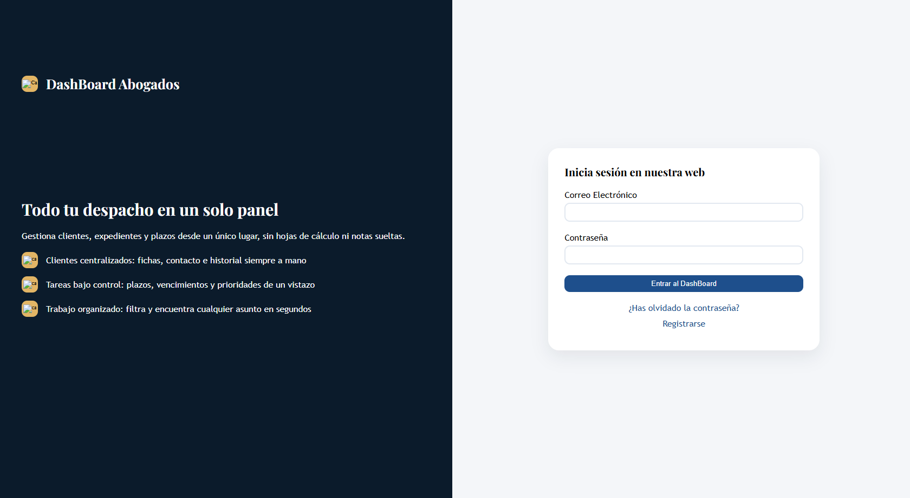
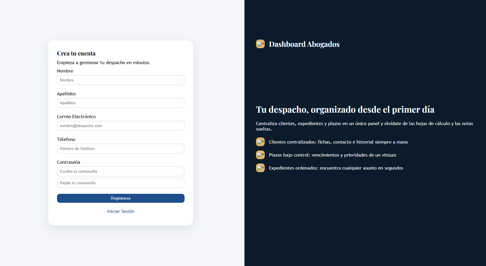
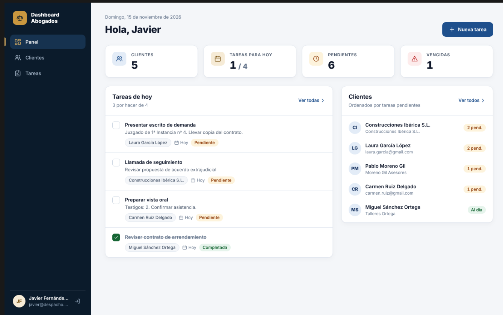
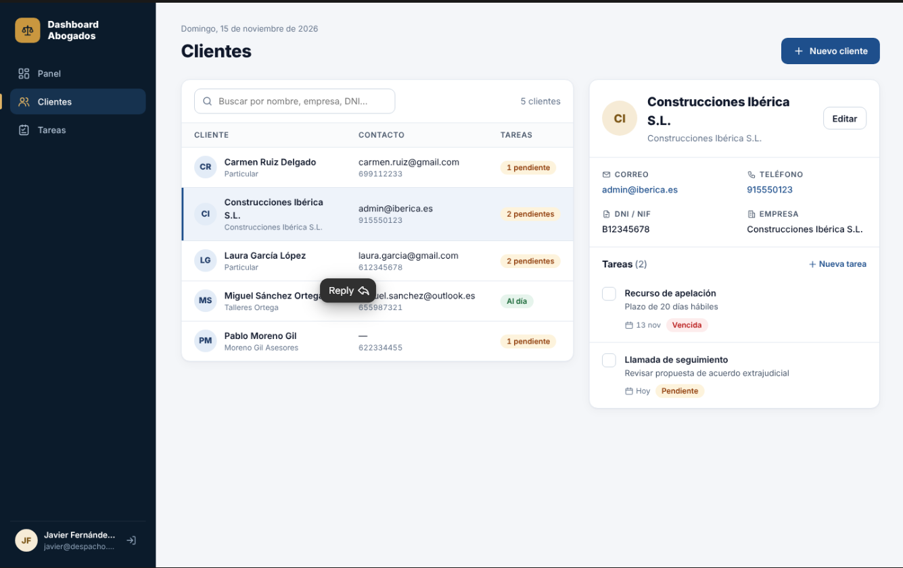
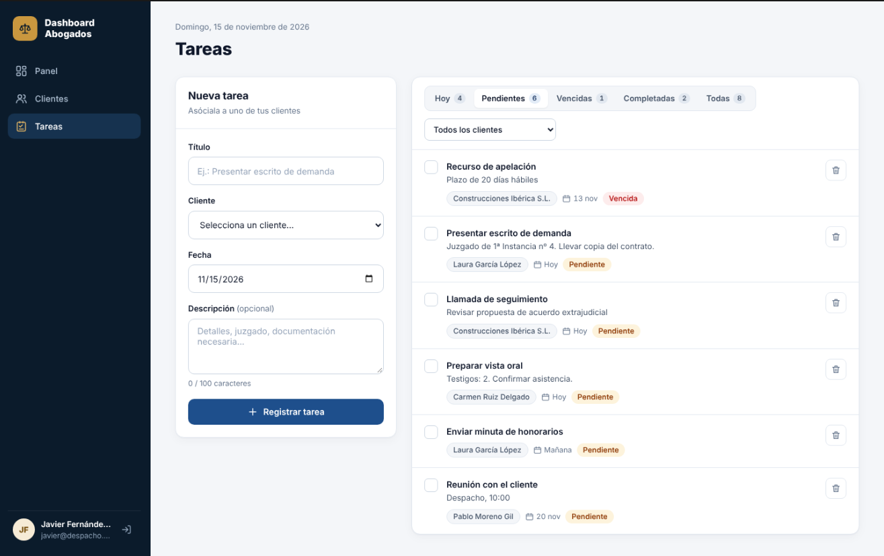
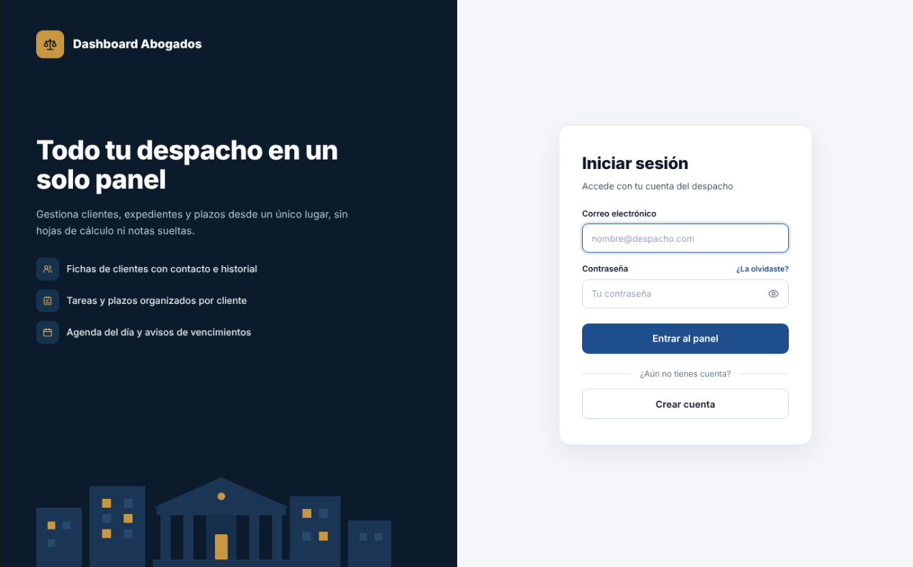
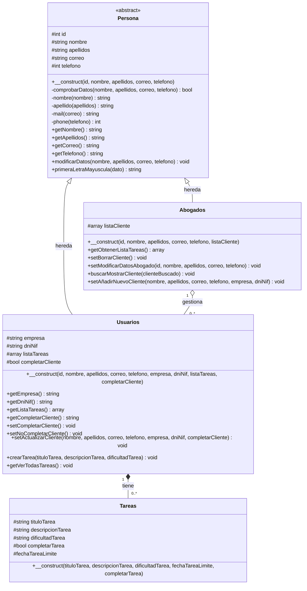
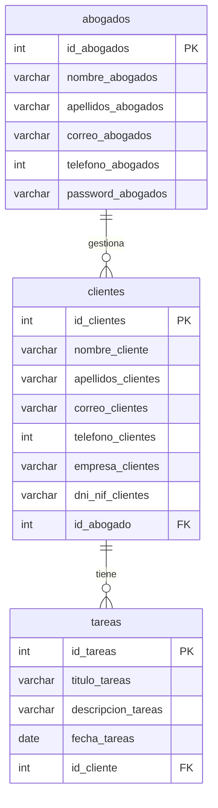

# ⚖️ Agenda Lex · Dashboard para despachos de abogados

Aplicación web para que cada abogado gestione su despacho desde un único panel: sus **clientes**, las **tareas** de cada cliente y los **plazos** que vencen.

Está construida con **PHP orientado a objetos y MySQL**, partiendo de un **diagrama de clases UML** y de un modelo de base de datos relacional diseñados antes de programar.

> 🚧 **Proyecto en desarrollo.** Ya funcionan el registro y el inicio de sesión de los abogados contra la base de datos. Ahora estoy con el panel, los clientes y las tareas. Más abajo tienes el [estado del proyecto](#-estado-del-proyecto) y el [diseño previsto](#-diseño-previsto).

---

## 🎯 Qué muestra este proyecto

| Área | Qué hay en el código |
| --- | --- |
| **Programación orientada a objetos** | Clase abstracta `Persona`, herencia (`Abogados` y `Usuarios`), encapsulación con `private` / `protected` / `public` y validación de datos en el constructor |
| **Diseño previo** | Diagrama de clases UML y diagrama entidad-relación de la base de datos |
| **Base de datos relacional** | 3 tablas relacionadas con claves foráneas (abogado → clientes → tareas) |
| **Consultas seguras** | PDO con sentencias preparadas y parámetros con nombre (`:email`) |
| **Autenticación** | Registro con comprobación de correo duplicado, inicio de sesión y sesiones PHP |
| **Configuración** | Credenciales fuera del código, en un archivo `.env` |
| **Frontend** | HTML, CSS y JavaScript con validación del formulario y transiciones que respetan `prefers-reduced-motion` |

---

## 📸 Capturas

### Resultado actual

| Inicio de sesión | Registro |
| --- | --- |
|  |  |

### 🎨 Diseño previsto

Prototipos de las pantallas que faltan por desarrollar:

| Panel principal | Clientes |
| --- | --- |
|  |  |
| **Tareas** | **Inicio de sesión** |
|  |  |

---

## 🛠️ Tecnologías

| Capa | Tecnología |
| --- | --- |
| Backend | PHP 8 (programación orientada a objetos) |
| Base de datos | MySQL 8 con PDO |
| Frontend | HTML, CSS y JavaScript |
| Entorno local | Laragon y HeidiSQL |
| Control de versiones | Git y GitHub |

---

## 🧩 Diagrama de clases (UML)

El modelo parte de una clase abstracta `Persona` con los datos comunes. De ella heredan los dos tipos de persona de la aplicación: el abogado y su cliente.



<sub>Versión en imagen: [`doc/uml-clases.png`](doc/uml-clases.png)</sub>

| Clase | Archivo | Responsabilidad |
| --- | --- | --- |
| `Persona` *(abstracta)* | `private/class/persona.php` | Datos comunes, validación al crear el objeto y formato de nombres. No se puede instanciar directamente. |
| `Abogados` | `private/class/abogados.php` | El usuario de la aplicación: gestiona su cartera de clientes y sus propios datos. |
| `Usuarios` | `private/class/clientes.php` | Un cliente del despacho: empresa, DNI/NIF, estado y su lista de tareas. |
| `Tareas` | `private/class/tareas.php` | Una tarea de un cliente: título, descripción, dificultad, fecha límite y si está completada. |

**Relaciones:**
- **Herencia:** `Abogados` y `Usuarios` reutilizan los datos y la validación de `Persona`.
- **Agregación (1 a muchos):** un abogado gestiona varios clientes.
- **Composición (1 a muchos):** cada cliente tiene sus propias tareas, que no existen sin él.

### Ejemplo: validación en la clase abstracta

Un objeto `Persona` solo se crea si sus datos son válidos. Si no lo son, el constructor lanza una excepción:

```php
abstract class Persona {
    protected int $id;
    protected string $nombre;
    // ...

    public function __construct($id, $nombre, $apellidos, $correo, $telefono) {
        if ($this->comprobarDatos($nombre, $apellidos, $correo, $telefono)) {
            $this->id = $id;
            $this->nombre = $this->nombre($nombre);   // "jAVIER" -> "Javier"
            // ...
        } else {
            throw new InvalidArgumentException("Algunos datos no son correctos");
        }
    }
}

class Abogados extends Persona { /* ... */ }
```

---

## 🗄️ Base de datos

La base de datos `abogados_bbdd` tiene 3 tablas encadenadas: cada abogado tiene sus clientes y cada cliente, sus tareas.



| Tabla | Qué guarda | Relación |
| --- | --- | --- |
| `abogados` | Los usuarios de la aplicación y sus credenciales | — |
| `clientes` | Los clientes de cada abogado | `id_abogado` → `abogados.id_abogados` |
| `tareas` | Las tareas de cada cliente con su fecha límite | `id_cliente` → `clientes.id_clientes` |

La estructura completa (solo estructura, sin datos) está en [`bdAgendaLex.sql`](bdAgendaLex.sql).

### Ejemplo: registro con sentencias preparadas

Antes de registrar a un abogado se comprueba que su correo no exista. Los datos nunca se concatenan en la consulta: van como parámetros, lo que evita la inyección SQL.

```php
// 1. ¿Existe ya ese correo?
$sql = "SELECT id_abogados FROM abogados WHERE correo_abogados = :email";
$stmt = $pdo->prepare($sql);
$stmt->execute(['email' => $emailUsuario]);

if ($stmt->fetch() === false) {
    // 2. No existe: se registra
    $sql = "INSERT INTO abogados (nombre_abogados, apellidos_abogados, correo_abogados, telefono_abogados, password_abogados)
            VALUES (:nombre_abogados, :apellidos_abogados, :correo_abogados, :telefono_abogados, :password_abogados)";
    $stmt = $pdo->prepare($sql);
    $stmt->execute([ /* ... */ ]);
}
```

---

## 🔐 Configuración y seguridad

- Las credenciales de la base de datos están en un archivo **`.env`** que **no se sube al repositorio** (está en `.gitignore`).
- `private/config/env.php` lee ese archivo y `private/config/bbdd.php` crea la conexión PDO.
- La conexión usa `ERRMODE_EXCEPTION` para capturar errores y `FETCH_ASSOC` para devolver los resultados como arrays asociativos.

> ⚠️ **Pendiente:** las contraseñas todavía se guardan sin cifrar. El siguiente paso es guardarlas con `password_hash()` al registrar y comprobarlas con `password_verify()` al iniciar sesión, ampliando `password_abogados` a `VARCHAR(255)`.

---

## 🚀 Cómo ejecutarlo en local

**Requisitos:** Laragon (o cualquier entorno con PHP 8 y MySQL 8).

1. Clona el repositorio dentro de la carpeta `www` de Laragon:
   ```bash
   git clone https://github.com/Javiier99/agenda-lex.git
   ```
2. Importa `bdAgendaLex.sql` (por ejemplo, desde HeidiSQL). El archivo crea la base de datos `abogados_bbdd` y sus tablas.
3. Crea un archivo `.env` en la raíz del proyecto con tus datos de conexión:
   ```
   DB_HOST=localhost
   DB_NAME=abogados_bbdd
   DB_USER=root
   DB_PASS=
   ```
4. Arranca Laragon y abre `http://localhost/agenda-lex/`.

---

## 📂 Estructura

```text
agenda-lex/
├── index.php                  # Inicio de sesión y registro
├── private/                   # Lógica del servidor
│   ├── class/                 # Clases: Persona, Abogados, Usuarios, Tareas
│   ├── config/                # env.php (lee .env) y bbdd.php (conexión PDO)
│   ├── procesos/verificacion/ # Inicio de sesión y registro contra la BD
│   └── accion/                # Altas de clientes y tareas (en desarrollo)
├── public/
│   ├── css/
│   ├── js/                    # Validación y transiciones del acceso
│   └── pages/                 # Panel, clientes y tareas
├── doc/
│   ├── img-proyecto/          # Prototipos (img-idea) y capturas reales (img-resultado)
│   └── uml-clases.png         # Diagrama de clases UML
└── bdAgendaLex.sql            # Estructura de la base de datos
```

---

## 📌 Estado del proyecto

- [x] Diagrama de clases UML y modelo de la base de datos
- [x] Clases `Persona`, `Abogados`, `Usuarios` y `Tareas`
- [x] Conexión a MySQL con PDO y credenciales en `.env`
- [x] Registro de abogados con comprobación de correo duplicado
- [x] Inicio de sesión y sesiones PHP
- [ ] Panel principal con resumen de clientes y tareas
- [ ] Gestión de clientes: alta, edición, búsqueda y borrado
- [ ] Gestión de tareas: crear, completar y filtrar por fecha límite
- [ ] Recuperación de contraseña
- [ ] Contraseñas cifradas con `password_hash()` y `password_verify()`

---

Hecho por **Fco. Javier Delgado** · [LinkedIn](https://www.linkedin.com/in/javier-dr/) · [Portfolio](https://marketingjdr.com/)
